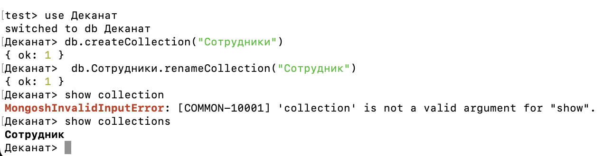
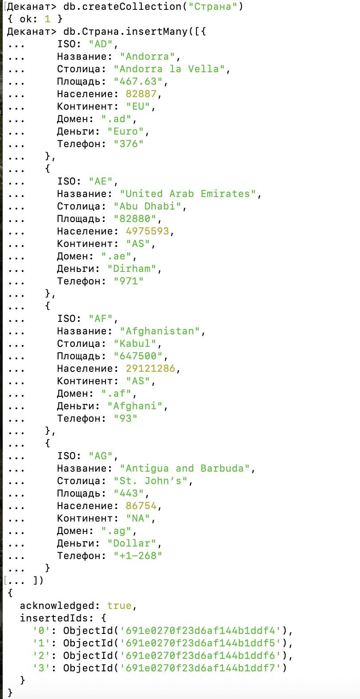
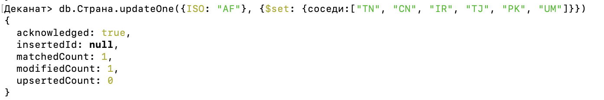
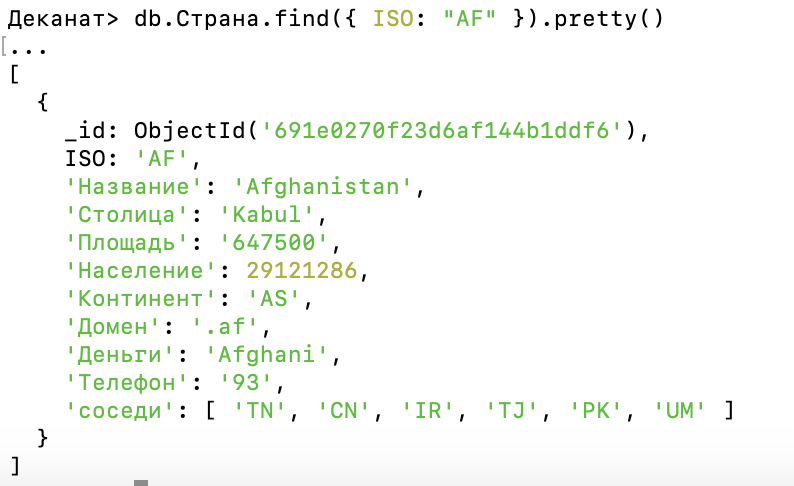
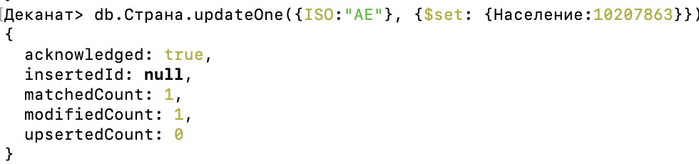
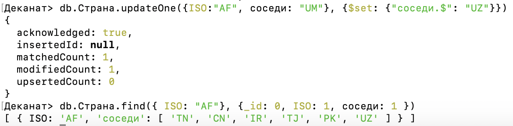
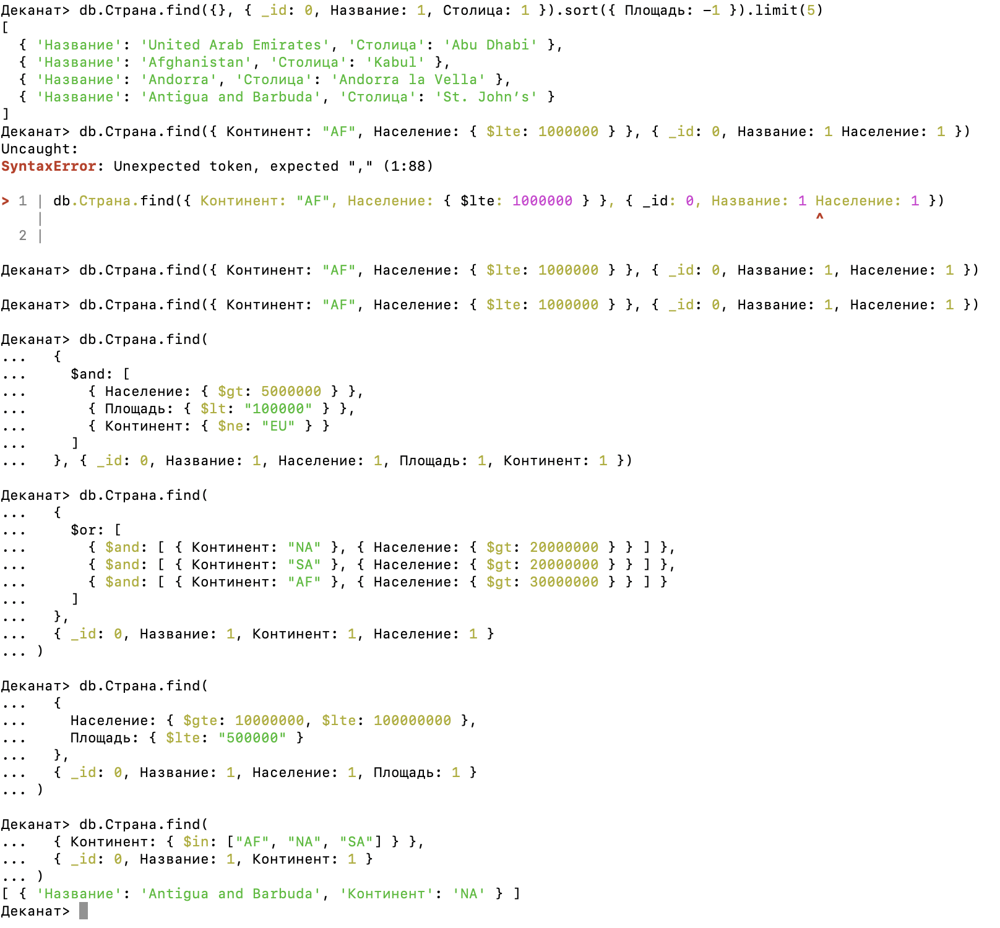

ЛАБОРАТОРНАЯ РАБОТА No 1
1. Создать базы данных «Деканат». 
2. Создать коллекцию «Сотрудники». 
68 
3. Переименовать коллекцию «Сотрудники» на «Сотрудник». 
4. Показать все коллекции. 

ЛАБОРАТОРНАЯ РАБОТА No 2
1. Создать коллекцию «Страна». 
2. Добавить в коллекцию «Страна» следующие документы:
3.  Для  документа  «Afghanistan»  добавить  «соседи»:  «TM»,  «CN»,  «IR»,  «TJ»,  «PK», 
«UM». 
4. «Население» для документа «United Arab Emirates» исправить на 10207863. 
5. Для документа «Afghanistan» изменить «соседи», исправляя «UM» на «UZ». 

ЛАБОРАТОРНАЯ РАБОТА No 3
1. Вывести название и столицу пяти наибольших стран по площади. 
2. Вывести список африканских стран, население которых не превышает 1 млн чел. 
3. Вывести  список  стран,  население  которых  больше  5  млн  чел.,  а  площадь  меньше 
100 тыс. км2, и они расположены не в Европе. 
4. Вывести  список  стран  Северной  и  Южной  Америки,  население  которых  больше 
20 млн чел., или стран Африки, у которых население больше 30 млн чел. 
5. Вывести список стран, население которых составляет от 10 до 100 млн чел., а пло-
щадь не больше 500 тыс. км2. 
6. Вывести список стран Африки, Северной и Южной Америки. 

